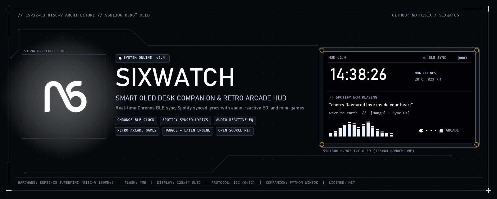
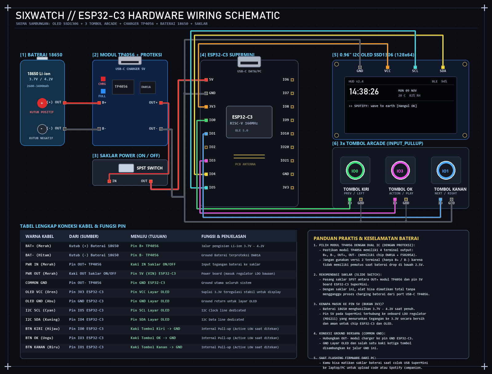

<p align="center">
  
</p>

# sixwatcs

Retro arcade console dan smartwatch mini berbasis ESP32-C3 SuperMini dengan layar OLED SSD1306 128x64 dan 3 tombol fisik.

Proyek ini menggabungkan 10 retro minigame, jam tangan pintar berbasis **Chronos**, dan pemutar musik Spotify dengan lirik tersinkronisasi serta visualizer equalizer audio-reaktif.

---

## Fitur Utama

### 1. Smartwatch & HUD (via Chronos)
Jam tangan menggunakan library **ChronosESP32** dan terhubung ke smartphone melalui aplikasi **Chronos** (Android):
- **Sinkronisasi Waktu Otomatis**: Jam dan tanggal sinkron via Bluetooth LE tanpa perlu setting manual. Waktu tersimpan di NVS (non-volatile storage) sehingga tidak hilang saat perangkat mati.
- **Notifikasi Pop-up**: Notifikasi pesan (WhatsApp, SMS, dll.) langsung muncul di layar OLED.
- **Status Ponsel**: Menampilkan persentase baterai ponsel dan indikator charging.
- **Cuaca**: Menampilkan suhu cuaca terkini dari ponsel.
- **Google Maps Navigation HUD**: Petunjuk arah turn-by-turn, jarak belokan, ikon arah, dan sisa waktu perjalanan otomatis tampil saat navigasi aktif di Google Maps HP.
- **AFK Screensaver**: Beralih otomatis ke tampilan jam setelah 5 menit tidak ada tombol yang ditekan.

### 2. Spotify Now Playing, Synced Lyrics & Audio EQ
Saat terhubung ke laptop/PC via kabel USB:
- **Tempo-Synced Lyrics**: Lirik lagu real-time dari LRCLIB yang bergulir presisi mengikuti durasi vokal lagu.
- **Dukungan Karakter Korea (Hangul 한글)**: Render karakter Hangul asli secara native di layar OLED (KS X 1001 / Gulim 11-12px) untuk lagu-lagu K-Pop tanpa kotak hilang atau karakter rusak.
- **Pre-Lirik Preview**: Menampilkan baris lirik berikutnya agar kamu tahu bait apa yang akan dinyanyikan selanjutnya.
- **Equalizer Audio-Reaktif**: 5 bar equalizer retro di pojok kanan atas bergerak dinamis mengikuti volume dan beat audio Windows (Core Audio API).
- **Kontrol Fisik Playback**: 3 tombol arcade fisik berfungsi sebagai kontroler media laptop (Lagu Sebelumnya, Play/Pause, Lagu Berikutnya).

### 3. 10 Retro Arcade Minigames
Menu carousel dengan animasi geser halus memuat 10 game retro yang dapat dimainkan menggunakan 3 tombol fisik:
1. **Flappy Bird**: Hindari pipa dengan timing lompat yang pas.
2. **Lunar Lander**: Kontrol thrust roket dan gravitasi untuk mendarat mulus.
3. **Cyber Runner**: Endless runner lompat rintangan.
4. **Copter**: Navigasi helikopter melewati celah sempit.
5. **Space Blast**: Tembak gelombang musuh luar angkasa.
6. **Stacker**: Tumpuk balok vertikal hingga puncak.
7. **Retro Snake**: Snake klasik dengan belokan 90 derajat.
8. **Brick Pop**: Paddle pong memantulkan bola untuk menghancurkan balok.
9. **Road Hopper**: Menyeberang jalanan penuh mobil dan sungai.
10. **Meteor Storm**: Hindari hujan meteor yang jatuh dari langit.

High score tiap game tersimpan otomatis di memory internal (NVS).

---

## Wiring & Skema Pin

<p align="center">
  
</p>

Hardware yang digunakan:
- Board: **ESP32-C3 SuperMini** (RISC-V 160MHz)
- Layar: **0.96" I2C SSD1306 OLED (128x64)**
- Kontrol: **3x Push Button tactile** (Active LOW, internal pull-up)
- Power: **Modul Charger TP4056 dengan IC Proteksi** (Type-C)
- Baterai: **Li-ion 18650 3.7V** (2600 - 3400 mAh)
- Saklar: **SPST Slide Switch** (Power ON/OFF)

### Tabel Sambungan Pin

| Komponen / Modul | Pin Modul | Terhubung Ke | Fungsi / Keterangan |
| :--- | :--- | :--- | :--- |
| **Baterai 18650** | Kutub Positif (+) | **Pin B+ TP4056** | Jalur pengisian Li-ion 3.7V - 4.2V |
| **Baterai 18650** | Kutub Negatif (-) | **Pin B- TP4056** | Ground Baterai & Proteksi DW01A |
| **Modul TP4056** | Pin OUT+ | **Kaki IN Saklar** | Jalur tegangan baterai ke saklar power |
| **Saklar ON/OFF** | Kaki OUT Saklar | **Pin 5V ESP32-C3** | Suplai power board via LDO ME6211 onboard |
| **Modul TP4056** | Pin OUT- | **Pin GND ESP32-C3** | Ground utama sistem (Common Ground) |
| **Layar OLED** | Pin VCC | **Pin 3V3 ESP32-C3** | Suplai 3.3V teregulasi stabil untuk display |
| **Layar OLED** | Pin GND | **Pin GND ESP32-C3** | Common Ground |
| **Layar OLED** | Pin SCL | **GPIO 5 ESP32-C3** | Dedicated I2C Clock |
| **Layar OLED** | Pin SDA | **GPIO 4 ESP32-C3** | Dedicated I2C Data |
| **Tombol Kiri** | Pin 1 / Pin 2 | **GPIO 0 & GND** | Previous / Left (Active LOW) |
| **Tombol OK** | Pin 1 / Pin 2 | **GPIO 3 & GND** | Action / Play-Pause (Active LOW) |
| **Tombol Kanan** | Pin 1 / Pin 2 | **GPIO 1 & GND** | Next / Right (Active LOW) |

> [!TIP]
> **Mengapa baterai masuk ke pin 5V (bukan 3V3)?**
> Baterai 18650 menghasilkan tegangan 3.7V hingga 4.2V saat terisi penuh. Pin **5V (VIN)** pada ESP32-C3 SuperMini memiliki regulator LDO onboard (*Low Dropout*) yang secara aman dan stabil menurunkannya ke 3.3V bersih untuk ESP32-C3 dan OLED. Gunakan pin **3V3** SuperMini untuk memberi daya pada OLED SSD1306.

---

## Kontrol 3 Tombol

| Mode / Layar | Tombol Kiri (GPIO 0) | Tombol OK (GPIO 3) | Tombol Kanan (GPIO 1) |
| :--- | :--- | :--- | :--- |
| **Menu Carousel** | Geser game sebelumnya | **Klik**: Buka game / menu<br>**Tahan**: Buka game | Geser game berikutnya |
| **Now Playing (Spotify)** | Lagu sebelumnya (Prev ⏮️) | **Klik**: Play / Pause ⏯️<br>**Tahan**: Kembali ke Menu | Lagu berikutnya (Next ⏭️) |
| **Retro Watch Face** | *Semua tombol*: Bangun dan kembali ke Menu Carousel |
| **Game Berjalan** | Aksi Kiri / Steer | Lompat / Tembak / Action<br>**Tahan**: Keluar ke menu | Aksi Kanan / Steer |

---

## Cara Pasang & Menjalankan

### 1. Flash Firmware ke ESP32-C3

#### Opsi A: PlatformIO (Direkomendasikan)
```powershell
# Build firmware
pio run

# Flash ke board via USB
pio run -t upload
```

#### Opsi B: Arduino IDE
1. Buka file `arduino_ide/esp32c3_oled_arcade/esp32c3_oled_arcade.ino`.
2. Di Library Manager, install pustaka:
   - `U8g2` by olikraus
   - `ChronosESP32` by fbiego
3. Pilih Board: **ESP32C3 Dev Module**.
4. Set konfigurasi board:
   - **USB CDC On Boot**: `Enabled`
   - **Partition Scheme**: `Huge APP (3MB No OTA / 1MB SPIFFS)`
5. Klik **Upload**.

---

### 2. Menjalankan Spotify Companion (Laptop / PC)

Pastikan dependensi Python terpasang:
```powershell
pip install pyserial requests winsdk pycaw
```

Jalankan script companion saat ESP32 terhubung ke laptop via USB:
```powershell
python scripts/spotify_pc_companion.py
```

Script akan otomatis mendeteksi port COM, membaca lagu yang sedang diputar di Spotify, mengunduh lirik sinkron dari LRCLIB, dan membaca audio peak untuk equalizer.

---

### 3. Menghubungkan ke HP Android (Chronos Smartwatch)

1. Pasang aplikasi **Chronos** di HP Android dari Play Store.
2. Pastikan Bluetooth dan Lokasi HP aktif.
3. Buka tab **Watches** -> **Pair New Device** -> cari **`Chronos ESP32`** (atau masukkan alamat MAC yang tertera di layar jam).
4. Setelah terhubung, waktu, cuaca, notifikasi WhatsApp, dan status baterai HP akan langsung sinkron ke OLED.

---

## Lisensi

Proyek ini dilisensikan di bawah lisensi [MIT](LICENSE).
